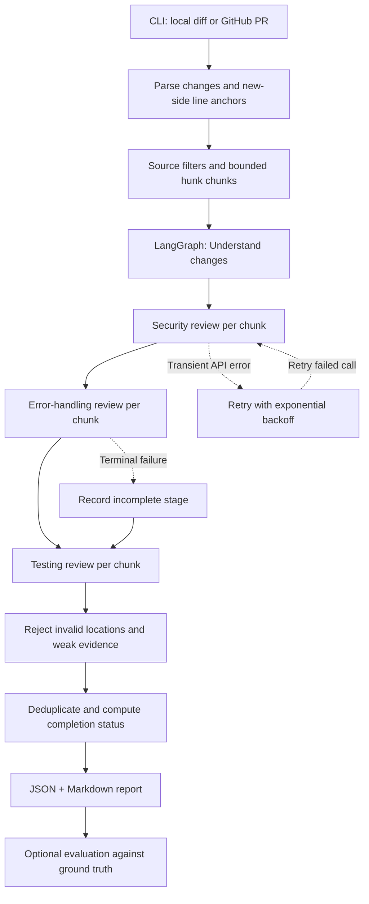

# Agentic Code Reviewer

**A portfolio-ready LangGraph code-review learning project.** This is a **runnable starter implementation**, not an independently verified production-grade security tool. It reviews local Git diffs or GitHub pull-request diffs, performs specialized LLM reviews, validates exact changed-line references, and measures precision/recall on labeled cases. It does **not** modify code, merge PRs, or post comments.

## 1. Problem statement

A normal LLM prompt such as "review this code" may hallucinate line numbers, produce a generic list of warnings, or silently omit files when the diff is too long. This project is built around:

1. Multi-step change understanding, security analysis, error-handling analysis, testing analysis, and final consolidation.
2. Precise Git **new-file line numbers**, rather than arbitrary or fabricated locations.
3. Chunking by diff hunk for large changes; if a size/price limit is hit, mark the report **PARTIAL**.
4. Bounded retries for transient API errors and honest partial-failure reporting.
5. Real bug-detection evaluation: TP, FP, FN, precision, recall, F1, and false alerts per evaluated case.
6. GitHub pull-request input using a read-only API endpoint.

## 2. Architecture



Note: the retries happen inside every LLM stage, not only security. `prepare` and `finalize` are deterministic; the other four stages use AI (one for understanding + three specialized reviews per chunk).

## 3. Files and what they do

```text
Agentic_Code_Reviewer_Project/
├── agentic_code_reviewer/
│   ├── __init__.py           # Package metadata
│   ├── __main__.py           # python -m agentic_code_reviewer entry point
│   ├── cli.py                # Commands and CLI flags
│   ├── diff.py               # Unified diff parser, new-line anchors, chunking
│   ├── github.py             # Read-only GitHub PR files API + pagination
│   ├── models.py             # Typed finding and understanding schemas
│   ├── prompts.py            # Untrusted-diff policy and specialist prompts
│   ├── llm.py                # OpenAI Structured Outputs + bounded retry
│   ├── workflow.py           # LangGraph nodes, validation, report status
│   ├── report.py             # JSON/Markdown exports
│   └── evaluation.py         # TP/FP/FN, precision, recall, F1
├── samples/
│   ├── vulnerable.patch      # Synthetic SQL injection regression
│   └── safe.patch            # Synthetic benign change
├── datasets/
│   ├── synthetic_cases.json  # Small evaluation demo, not a benchmark
│   └── historical_template.json # Template for real bug-fix commits
├── tests/
│   ├── test_diff.py          # Parser/chunk/line tests
│   ├── test_workflow.py      # Fully mocked agent flow, no API cost
│   └── test_evaluation.py    # Metrics math and matching
├── .env.example              # Model/API configuration
├── .gitignore                # Do not commit tokens and review reports
├── requirements.txt
├── pyproject.toml
└── README.md
```

## 4. Prerequisites

- Windows 10/11 with PowerShell / Git Bash, or Linux/macOS.
- Python **3.11+** (`python --version`).
- Git installed (`git --version`).
- An OpenAI API key with appropriate available model and billing configuration.
- A GitHub token is optional for public repos, but useful to avoid rate limits; private repos require permission.

### 4.1 Windows PowerShell (recommended)

Open PowerShell in the extracted project directory:

```powershell
python -m venv .venv
.\.venv\Scripts\Activate.ps1
python -m pip install --upgrade pip
python -m pip install -e ".[dev]"
Copy-Item .env.example .env
```

If PowerShell prevents venv activation, you can call `.venv\Scripts\python.exe` directly, or use Git Bash. Do not change machine-wide execution policy just for this demo.

### 4.2 Git Bash

```bash
python -m venv .venv
source .venv/Scripts/activate  # Windows Git Bash
# on Linux/macOS: source .venv/bin/activate
python -m pip install --upgrade pip
python -m pip install -e '.[dev]'
cp .env.example .env
```

Edit `.env` with your own key:

```ini
OPENAI_API_KEY=your_actual_key_here
REVIEW_MODEL=gpt-5-mini
GITHUB_TOKEN=
```

Choose a model that **actually supports OpenAI Structured Outputs** in your account; availability and pricing vary. Never put API keys in your code, screenshots, commits, or shared reports.

### 4.3 Run offline unit tests first

```bash
python -m pytest -q
```

The unit tests use mocks and make **zero OpenAI requests**.

## 5. First end-to-end run: synthetic injection example

```bash
python -m agentic_code_reviewer review-diff samples/vulnerable.patch --output reports/sql-example.json
```

Expected output **paths**:

```text
reports/sql-example.json
reports/sql-example.md
```

The synthetic source change introduces raw SQL string interpolation on the new-file line **54**. A successful reviewer *should* detect this as a security defect, but model responses are nondeterministic: the exercise is to measure whether it does so, not to assume it will.

Try a benign diff:

```bash
python -m agentic_code_reviewer review-diff samples/safe.patch --output reports/safe-example.json
```

A good reviewer should avoid raising spurious warnings here.

## 6. Review a real change from your local Git repo

In a repository you are allowed to send to your chosen model provider:

```bash
git diff --no-ext-diff HEAD~1 HEAD > changes.patch
```

Then call the reviewer with the saved file (from the project directory, or use a full path):

```bash
python -m agentic_code_reviewer review-diff /path/to/changes.patch --output reports/my-change.json
```

To review your uncommitted working-tree changes, run `git diff > changes.patch`. **Untracked files are not included** in this diff.

For Windows, a full path can be used as the diff argument.

## 7. Review a GitHub pull request

```bash
python -m agentic_code_reviewer review-pr --repo OWNER/REPO --pr 123 --output reports/pr-123.json
```

The code requests `GET /repos/{owner}/{repo}/pulls/{pull_number}/files` using 100 files per page. The GitHub API omits `patch` for some files; each omission is explicitly marked as skipped. GitHub caps this endpoint at 3,000 files per PR; the implementation refuses to claim complete coverage at that cap.

**GitHub safety:** public data can be fetched without a token subject to rate limits. For private repos, use the minimum `Pull requests: read` permission. This starter makes no PR comments and asks for no write permission. Review your organization's code-sharing policy before sending proprietary diffs to an external model API.

## 8. How the six LangGraph steps work

### Step 1 — `prepare`

- Parse Git files or the GitHub API `patch` field.
- Keep supported source files; unsupported assets are recorded as skipped.
- Parse Git `@@ -old +new @@` hunk headers and map each `+` line to its **new-file** line number.
- Split hunks into chunks bounded by `max_chars`.
- Limit chunks according to `max_chunks`, displaying an explicit `PARTIAL` status when the limit is exceeded. This is a *request-count limiter*, not a guaranteed INR/dollar spending cap.

**File:** `diff.py`, called by `workflow.py`.

### Step 2 — `understand_changes`

- Ask the LLM to summarize the change intent and likely risk areas.
- Bound the high-level overview context for predictable cost.
- If only part of the diff was visible to the summary step, report `understanding_scope` as sampled.
- On failure, preserve the error and continue to specialized stages.

**Files:** `prompts.py`, `llm.py`, `workflow.py`.

### Step 3 — `security_review`

- Scan every admitted chunk for evidence-backed security issues, e.g., SQL injection or missing authorization.
- Insist on valid new-side `+` line numbers.
- Ignore the diff as instructions (prompt-injection mitigation).

### Step 4 — `error_handling_review`

- Examine unchecked results, missing exception/resource handling, and other likely correctness defects.
- Report only demonstrable issues introduced by the changed lines.

### Step 5 — `testing_review`

- Assess whether a consequential new behavior appears to lack an important test.
- Explicitly avoid claiming that a test is absent across the *entire repository* just because it was not in the diff.
- Encourage coverage suggestions conservatively; this stage has less context than a repository-wide coverage tool.

### Step 6 — `finalize_report`

- Require `path` and `line` to correspond to a genuine changed-source line.
- Discard off-topic findings and those below the configured confidence threshold.
- Deduplicate findings by `(file, line, category)`.
- Compute coverage, warnings, failures, and `COMPLETE` vs `PARTIAL`.
- Save JSON + Markdown reports.

**Important nuance:** a valid line number does not prove a warning is correct. Grounding is only one reliability layer; historical evaluation and human review are still necessary.

## 9. Reliability and fallback design

| Failure scenario | Current behavior |
|---|---|
| OpenAI rate limit, transient 5xx, network/timeout | Retry with capped exponential backoff (up to 3 attempts by default) |
| Bad API key or unsupported model | Do not endlessly retry; each review stage records failure |
| Structured-output refusal/truncation | Fail that step; record the incomplete stage, no invented findings |
| Large diff | Split on hunk/line boundaries into manageable chunks |
| More than `--max-chunks` chunks | Review first N chunks, mark report `PARTIAL` |
| GitHub omits `patch` for a file | Record skipped file; mark report `PARTIAL` |
| Finding references a nonexistent/new-side unchanged line | Reject finding, record a warning |
| A whole stage fails for one chunk | Continue other stages/chunks; count missing coverage |
| No findings detected after a failed stage | Report `PARTIAL`, never claim clean code |

This starter has **in-process retries**, but not persistent LangGraph checkpointing, distributed jobs, caching, automatic replay after a process crash, or file-level full-repository retrieval. Those are recommended upgrades, not features falsely claimed to exist.

## 10. Evaluation: actual bugs caught vs false alarms

### 10.1 Key definitions

- **TP (true positive):** a finding matches a manually verified real bug by path, new-side line, and category.
- **FP (candidate false positive):** an AI finding does not match any gold bug in the reviewed case.
- **FN (false negative):** a verified real bug the reviewer did not identify.
- **Precision:** `TP / (TP + FP)`.
- **Recall:** `TP / (TP + FN)`.
- **F1:** harmonic mean of precision and recall.
- **False alerts per case:** `FP / number_of_complete_cases`.

If the ground truth isn't exhaustive, unmatched findings are **not definitively false**; manually investigate them. Cases with partial reviews are **excluded** from the headline metrics and listed under `excluded_cases`. When there are no positives, precision/recall are `null` rather than misleadingly 100%.

### 10.2 Run the included tiny synthetic evaluation

```bash
python -m agentic_code_reviewer run-eval --dataset datasets/synthetic_cases.json --reports-dir reports/eval
```

This calls the API for two cases and writes reports. To recalculate scores without API calls:

```bash
python -m agentic_code_reviewer evaluate --dataset datasets/synthetic_cases.json --reports-dir reports/eval
```

**Do not claim benchmark-grade performance using these two synthetic examples.** They are useful only for verifying the workflow and metrics end-to-end.

### 10.3 Build your historical-bug dataset (most important research step)

Find verified commits in a mature open-source project where a bug was introduced and fixed later. Recommended sequence:

1. Find a fix issue/PR with an explicit reproduction test and identified root cause.
2. Use `git blame`, PR discussions, or a regression test to identify the **introducing commit**, not merely the fix commit.
3. Checkout the public repository, and export the **introducing diff**:

   ```bash
   git show --format= --no-ext-diff INTRODUCING_SHA > introducing-change.patch
   ```

   For a merge commit, establish the correct first-parent comparison explicitly; `git show` defaults can be misleading. 

4. Review the actual bug's **new-side** file and line in that introducing diff. A diff-only reviewer cannot identify unchanged legacy bugs that appear nowhere in the diff.
5. Add the patch under `samples/` and annotate `datasets/historical_template.json` (rename the dataset after inserting real cases).
6. Require a reviewer to validate the labels **before** running the model, so labels are not invented based on its output.
7. Include matched clean/negative changes from similar repositories to measure false alarms.
8. Run `run-eval` (specify your new dataset), inspect unmatched alerts, and have a human determine whether they are real false positives or missing gold labels.
9. Measure precision/recall overall and by category, with confidence intervals for a meaningful portfolio benchmark.
10. Split datasets by **repository and chronology** when tuning prompts, to avoid leakage from previously seen fixes.

For a starting point, consider [BugsInPy](https://github.com/soarsmu/BugsInPy), which provides reproducible buggy/fixed Python project versions, or [SWE-bench](https://www.swebench.com/SWE-bench/faq/) for issue/fix histories. SWE-bench is designed for patch generation, not review of bug-introducing commits, so either dataset **requires additional work** to locate and label the introducing diffs. Verify every original commit and bug label. The included `historical_template.json` is **only a template** and does not claim to contain real historical bugs.

### 10.4 Example interpretation

Suppose you carefully validate **50 known bugs**, and the model catches 42, misses 8, and raises 7 incorrect alerts:

```text
True positives = 42
False positives = 7
False negatives = 8
Precision = 42 / (42 + 7) = 85.71%
Recall    = 42 / (42 + 8) = 84.00%
F1        = 84.85%
```


## 11. Practical improvements (phase 2)

- **Full-file context on demand:** GitHub file contents API at exact PR SHAs, limiting retrieved tokens and never executing code.
- **Static tools:** Semgrep/Bandit/ruff for complementary signals in a sandbox; rule hits should be verified, not automatically equated with real defects.
- **Review verifier agent:** independent severity/evidence checker before emitting comments.
- **Persistent state:** LangGraph checkpointer with SQLite/PostgreSQL, stage receipts and resumability after crashes.
- **Observability:** LangSmith or OpenTelemetry tracing with token usage, latency, retries, and cost per review, avoiding source code/secrets in traces.
- **GitHub App:** read-only webhook intake; optional inline comment publication *only with explicit user authorization and scoped write permissions*.
- **Dashboard:** Streamlit or FastAPI web view to browse findings, diff snippets, evaluation metrics and failed stages.
- **Quality gates:** configurable minimum confidence, no-failure requirement, alert severity, evaluation regression thresholds.
- **Better semantic evaluation:** multiple acceptable line ranges and human-adjudicated matches, plus calibration of model confidence.
- **More precise context:** one combined commit-level test-coverage view rather than assuming missing tests from a single diff chunk.

## 12. Security limitations

1. **Never execute untrusted PR code** on the machine running the reviewer. This project does not execute supplied source code.
2. Diff content is treated as untrusted data; prompt-injection defense is best-effort, not a mathematical guarantee.
3. **Do not transmit credentials, secrets, private personal data, or proprietary code** to a model provider unless your organization allows it. `.env` is excluded from Git, but secrets hardcoded *inside a diff* are not automatically redacted by this starter.
4. This is not a substitute for human review, SAST, secret scanning, unit/integration tests, or branch protection.
5. Github PR file patches can be omitted for binary, truncated, very large, or unavailable files; report coverage carefully.
6. Model-estimated confidence is not necessarily calibrated probability; never assume high confidence means the issue is real.
7. GitHub API support shown targets **github.com**; enterprise hosts require separately implemented authentication/URLs.

## 13. Practical interview explanations

**Why LangGraph rather than one model call?** Specialized nodes make each type of review measurable, allow partial-failure recovery and enable auditing coverage per chunk and review category.

**Why use structured outputs?** Pydantic contracts guarantee the model response has predictable fields/types when parsing succeeds. Deterministic checks still verify actual file/line anchors and category.

**How do you handle context overflow?** Parse hunks, split very long hunks into bounded pieces, count skipped lines and budget-limit omissions, never claim complete coverage for them.

**How do you measure quality?** Curate introducing commits with independently verified bug labels, include negative changes, then compute TP/FP/FN and precision/recall. Investigate every unmatched finding.

**What happens if a model call fails?** Retry only transient errors. If a review chunk is still unavailable, record the exact stage/chunk and mark the final result PARTIAL instead of returning an apparently clean PR.

**Why not auto-merge or auto-reject PRs?** False positives, missing repository context, and model nondeterminism make unattended merge decisions unsafe. Human approval remains in control.

## 14. Project status

### Implemented in this starter

- Local full unified diff and GitHub PR file intake
- LangGraph orchestration (four AI analysis stages + deterministic prepare/finalize)
- Chunking, source filtering, real new-side change line numbers
- Security, error-handling, testing finding prompts
- Structured OpenAI/Pydantic output with validated line anchors
- Transient retries, failure logs, partial-review visibility
- JSON and Markdown exports
- Synthetic evaluation cases + historical case template
- Unit tests that do not require an OpenAI API key

### Not yet implemented

- User interface and cloud deployment
- GitHub PR inline comment publication/webhooks
- LangSmith tracing and persistent checkpointer
- Automated historical benchmark download/label curation
- Independent verifier agent or full-repo context fetch
- Verified production security hardening

**Next milestone:** run the sample and tests; verify the actual model findings, then curate the first 10–20 real historical regression cases and collect initial metrics.
